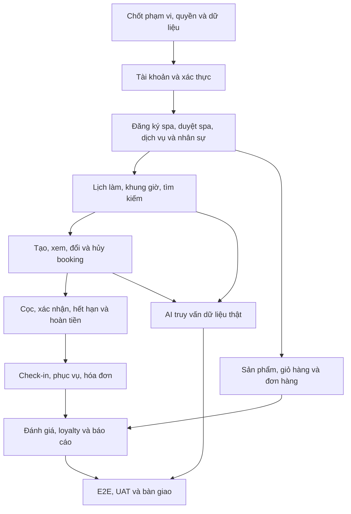

# Kế hoạch Aura Spa — Dương Trường Sơn

Ngày lập: 04/11/2026. Đối tượng: Sơn (Product Owner kiêm developer) và nhóm 18.

## 1. Mục tiêu và cách sử dụng

Kế hoạch bao phủ toàn bộ 71 story trong workbook, giữ nguyên mã story và người phụ trách chính. Đây là đề xuất thực hiện, không phải xác nhận tiến độ hay thay đổi phạm vi đã được giảng viên duyệt. Ngày ở phụ lục là baseline trong Excel; ngày kiểm kê, quyết định và kiểm thử dưới đây là mốc đề xuất.

Kết quả cần đạt: một hành trình thực sự chạy từ tìm spa → đặt lịch → cọc → phục vụ → hóa đơn → phản hồi; các luồng cửa hàng, AI, ưu đãi và báo cáo tích hợp vào dữ liệu này. Mỗi story có người chịu trách nhiệm, tiêu chí nghiệm thu và bằng chứng.

Đọc mục 2–5 trước khi lập trình; mục 6 là kế hoạch riêng của Sơn; phụ lục cuối file chứa toàn bộ story, phân công, subtasks và deadline gốc.

## 2. Hiện trạng đã kiểm tra và giới hạn kết luận

| Hạng mục | Bằng chứng trong workspace | Kết luận dùng để lập kế hoạch |
|---|---|---|
| Frontend | `aura-spa-frontend/src/app`, context và các service | Có giao diện cho nhiều chức năng; chưa kiểm thử runtime trong lần lập kế hoạch này |
| Backend | `src/app.module.ts`, `src/main.ts`, `modules/branch/branch.module.ts` | Có khung NestJS, cấu hình TypeORM, entity Branch; chưa thấy module/API nghiệp vụ khác trong cây `src` hiện tại |
| Dữ liệu và môi trường | Có cấu hình kết nối trong code | Chưa xác minh database, migration, dữ liệu thật hoặc môi trường deploy |
| Tiến độ | Các sheet Sprint ghi Open | Chưa thể kết luận đã làm xong hay chưa chỉ từ Excel hoặc số màn hình |
| Backend ở nơi khác | Chưa có bằng chứng trong phạm vi kiểm tra | Sơn cần kiểm kê repo/nhánh/môi trường của nhóm trước khi quyết định xây tiếp |

Không đồng nhất “có giao diện”, “có API”, “API chạy với database” và “đã nghiệm thu”. Theo dõi riêng bốn trạng thái này cho mỗi story.

## 3. Những quyết định phải chốt trước

Sơn tập hợp phương án, Minh ghi biên bản và tác động; cả nhóm thống nhất, đưa các thay đổi phạm vi cho giảng viên review. Kế hoạch tạm lấy Overview/Product Backlog 6 sprint và mô hình nhiều spa độc lập làm baseline vì chứa 71 story cùng phân công chi tiết.

| ID | Nội dung cần chốt | Đề xuất để thảo luận | Kết quả cần lưu |
|---|---|---|---|
| D01 | Nhiều spa độc lập hay một chuỗi nhiều chi nhánh? | Bám workbook: nhiều spa; tận dụng giao diện hiện tại sau khi xác định lại mô hình | Sơ đồ tổ chức dữ liệu và phạm vi được thống nhất |
| D02 | 6 sprint hay 3 sprint? | Dùng 6 sprint ở Overview; đánh dấu phần Process 3 sprint là mâu thuẫn cần giải quyết | Một lịch duy nhất được nhóm xác nhận |
| D03 | Các role và phạm vi dữ liệu | Phân biệt Admin nền tảng, chủ spa, nhân viên và khách; định nghĩa quyền manager nếu giữ | Ma trận role × hành động × spa |
| D04 | Một booking nhiều dịch vụ | Chốt thứ tự dịch vụ, tổng thời gian, một hay nhiều kỹ thuật viên | Quy tắc và ví dụ lịch cụ thể; schema/API tương ứng |
| D05 | Khách không có tài khoản | Đặt lịch qua OTP; xác định cách tra cứu, đổi/hủy booking an toàn | Luồng OTP và quyền truy cập booking khách vãng lai |
| D06 | Chính sách tiền, hủy và đổi giờ | Review BR-01–BR-03; chưa coi các con số đề xuất là đã duyệt | Bảng chính sách, ví dụ biên và ngày hiệu lực |
| D07 | OTP và khóa đăng nhập | Chốt BR-04; thống nhất 15 phút trong tài liệu với 30 phút ở client hiện tại | Quy tắc do backend thực thi, thông báo UI khớp |
| D08 | Báo cáo doanh thu | Tách tiền đã thu, hoàn tiền và giá trị booking; chốt chỉ tiêu “doanh thu” | Công thức, trạng thái và mốc thời gian được tính |
| D09 | Cổng thanh toán và dịch vụ ngoài | Chọn sandbox phù hợp với môi trường sẵn có; xác định webhook và dữ liệu demo | Người phụ trách, cấu hình, kế hoạch kiểm thử |
| D10 | Địa bàn và dữ liệu quận/khu vực | Xác nhận bộ dữ liệu dùng cho bài theo yêu cầu giảng viên; ghi phiên bản | Danh mục seed thống nhất, không tự suy diễn thay đổi địa giới |

Các trường hợp cần bổ sung cho BR: booking tổng dưới mức cọc tối thiểu; cọc tính trước/sau giảm giá; giá thay đổi sau đặt; dịch vụ chạm giờ đóng cửa; booking qua ngày; giữ chỗ trong khi chờ cọc; thanh toán đến sau khi hết hạn; hủy khi thanh toán đang xử lý. Mỗi trường hợp cần một kết quả duy nhất để code và test.

## 4. Thứ tự triển khai và phụ thuộc

Tạo môi trường dev/staging và smoke deploy sớm, không chờ tới U069 mới thử triển khai. U069 chịu trách nhiệm bản bàn giao cuối.

Các nhóm việc có thể làm đồng thời sau khi thống nhất contract: UI với fixture rõ ràng, API với test, seed dữ liệu và kịch bản kiểm thử. Fixture chỉ chứng minh UI; nghiệm thu bắt buộc chạy với API/database thật hoặc sandbox được công bố.

### 4.1 Kiến trúc dữ liệu đề xuất để review

| Nhóm | Dữ liệu cốt lõi | Điểm phải thống nhất |
|---|---|---|
| Danh tính | user, OTP/session, membership/role | Quyền theo spa; nhân viên thuộc đâu; tài khoản bị khóa |
| Spa | spa, ảnh/giấy tờ, dịch vụ, nhân viên và kỹ năng | Tách spa độc lập với branch nếu thực sự có cả hai |
| Lịch | ca làm, nghỉ phép, năng lực khung giờ | Khung giờ phải xét đủ thời lượng dịch vụ và nhân sự |
| Booking | booking, booking_service, phân công, lịch sử trạng thái | Chụp giá/thời lượng lúc đặt; xử lý hai khách tranh chỗ bằng transaction/khóa hoặc ràng buộc phù hợp |
| Tiền | payment, refund, invoice, invoice_item | Số tiền do server tính; mã sự kiện thanh toán duy nhất; không ghi nhận lặp |
| Store | product, stock movement, order, order_item | Đơn thuộc một spa; chốt thời điểm giữ/trừ/hoàn tồn kho |
| Sau dịch vụ | review, complaint, promotion, course, loyalty | Điều kiện hợp lệ; tránh cộng/trừ lặp khi retry |
| Hệ thống | notification, conversation/message, ai_log, audit_log | Lịch chạy job, quyền đọc, truy vết thay đổi |

Tên bảng là đề xuất thiết kế; Dũng đối chiếu ERD hiện có trước khi tạo hoặc đổi schema. Không sửa database thật trong bước lập kế hoạch.

### 4.2 Contract chung trước khi ghép frontend/backend

- Chọn base URL và cổng API khác cổng frontend; kiểm tra `NEXT_PUBLIC_API_URL`, CORS, credentials và callback.
- Mỗi endpoint ghi request, response, phân trang, lỗi nghiệp vụ và quyền truy cập. Khớp cơ chế unwrap response trong `src/lib/api.ts`.
- Dùng một enum trạng thái booking/payment/order trong API và frontend; xác định hành động nào đổi trạng thái nào.
- Thống nhất ID spa/branch, kiểu tiền, múi giờ Asia/Bangkok và quy ước lưu/truyền timestamp.
- Có dữ liệu demo cho ít nhất hai spa để kiểm thử cách ly; có kỹ thuật viên, ca nghỉ, lịch trùng và dữ liệu tiền để đối soát.
- Kiểm tra quyền thật ở backend. Cookie role hoặc localStorage trên frontend chỉ hỗ trợ giao diện/chuyển trang.

## 5. Lịch toàn dự án và cổng nghiệm thu

### 5.1 Baseline 6 sprint từ workbook

| Sprint / ngày gốc | Mục tiêu và phạm vi | Điều kiện qua cổng |
|---|---|---|
| S1: 28/09–09/10 | U001–U005: phạm vi, backlog, ERD, wireframe, repo/môi trường | Có bản yêu cầu thống nhất, sơ đồ dữ liệu, seed và hướng dẫn chạy |
| S2: 12/10–23/10 | U006–U018: tài khoản, spa, dịch vụ, nhân sự, ca làm | Spa được duyệt mới công khai; role và quyền theo spa chạy thật; API có kiểm thử |
| S3: 26/10–06/11 | U019–U034: khám phá, đặt/đổi/hủy, walk-in, Việt/Anh | Từ tìm spa đến booking lưu thật; xử lý tranh chỗ và lỗi quyền |
| S4: 09/11–20/11 | U035–U048: cọc, phục vụ, hóa đơn, store | Đối soát được tiền và tồn kho; webhook/retry/hết hạn chạy đúng |
| S5: 23/11–04/12 | U049–U062: AI, đánh giá, khiếu nại, ưu đãi, loyalty, thông báo | AI lấy dữ liệu thật; đánh giá/điểm/ưu đãi tuân điều kiện; job không gửi lặp |
| S6: 07/12–18/12 | U063–U071: báo cáo, log, E2E, UAT và bàn giao | Báo cáo đối soát được; UAT hoàn tất; demo deploy chạy được và tài liệu khớp |

Các sprint trước ngày 04/11 cần kiểm kê bằng chứng, không đánh dấu hoàn thành mặc định. Phân công gốc của toàn bộ 71 story nằm trong phụ lục.

### 5.2 Kế hoạch kiểm kê và phục hồi từ 04/11

| Mốc đề xuất | Sơn | Các thành viên phối hợp | Đầu ra |
|---|---|---|---|
| 04/11, phiên 1 | Đối chiếu repo/nhánh/demo; lập ma trận trạng thái 71 story | Mỗi PIC cung cấp commit, API, màn hình, test và blocker | Biết chính xác phần chạy thật, phần chỉ có UI và phần thiếu |
| 04/11, phiên 2 | Chốt D01–D05, D07; review U025 | Minh ghi quyết định; Dũng rà ERD; Linh rà availability; Thông rà spa/service | Mô hình và contract booking thống nhất |
| 05/11 | U025: hoàn thiện phần khả thi theo tình trạng backend; ghép slot và kỹ thuật viên | Linh U024, Dũng U026, Thông U023/U027, Minh U028 | Một lượt đặt lịch tích hợp nếu các phụ thuộc đã sẵn sàng |
| 06/11 | U034: chạy E2E, tổng hợp lỗi, demo và báo cáo phần thiếu | Cả nhóm sửa lỗi theo mức chặn luồng | Review trung thực; quyết định lịch cập nhật nếu trượt cổng S3 |
| 09/11 | Review cổng S2/S3 trước Planning S4; chốt policy tiền và contract payment | Minh và các PIC payment | Sprint Backlog phù hợp năng lực thật |

Nếu không có backend đầy đủ ở repo/nhánh khác: 05–06/11 là mốc kiểm kê, làm một lát cắt tích hợp và lập lại lịch, không cam kết toàn bộ S3. Ước lượng lại từng story với PIC; giữ nguyên deadline gốc để thể hiện chênh lệch, thêm forecast mới. Bất kỳ giảm phạm vi nào phải được nhóm/giảng viên thống nhất; không âm thầm bỏ guest booking, nhiều dịch vụ, store hoặc AI.

### 5.3 Chia nhịp thực hiện các sprint còn lại

| Khoảng thời gian | Việc của Sơn | Việc cần sẵn sàng từ nhóm | Kết quả review |
|---|---|---|---|
| 09–13/11 | U035: schema/contract payment, API yêu cầu cọc, QR, countdown, lỗi | Minh webhook/job U036; Dũng xác nhận thủ công U037; Linh refund U038 | Cọc đúng tiền, đúng hạn, không nhận lặp |
| 16–19/11 | U043: danh sách/tìm/lọc sản phẩm; ghép dữ liệu sản phẩm thật | Thông catalog U042; Minh giỏ U044; Dũng/Linh đơn U045/U046 | Khách tìm được hàng và chuyển sang mua |
| 19–20/11 | U048: kiểm thử tiền, refund và đơn; sửa blocker | PIC từng luồng hỗ trợ dữ liệu/test | Sổ đối soát tiền và tồn kho; demo S4 |
| 23–27/11 | U049: contract chat, các hàm truy vấn, tích hợp AI và UI | Minh U050; Dũng U051; Linh U052; Thông U053/U054 | AI đưa gợi ý có nguồn dữ liệu thật |
| 30/11–01/12 | Hoàn thiện U049; kiểm thử AI, lỗi timeout và không có lịch | Nhóm ghép đặt lịch từ gợi ý | Demo AI end-to-end |
| 02–04/12 | U059: khuyến mãi; ghép booking/payment, kiểm thử cạnh tranh lượt dùng | Chủ các module booking/payment phối hợp | Mã hợp lệ mới giảm; tiền cuối do backend tính |
| 07–10/12 | U063: định nghĩa báo cáo, truy vấn, UI, đối soát | Dữ liệu invoice/payment/refund/order đã ổn định | Báo cáo khớp bộ dữ liệu kiểm chứng |
| 11–15/12 | U069: hoàn thiện staging/deploy, cấu hình, smoke test; chốt U063 | Thông tài liệu U067; Minh kiểm thử U070 | Release candidate dùng được từ môi trường demo |
| 16–17/12 | Hỗ trợ E2E/UAT và sửa lỗi; diễn tập demo, kiểm tra khôi phục | Linh U066/U071; Dũng U068 | Danh sách lỗi còn lại và kết quả nghiệm thu |
| 18/12 | Smoke test cuối, bàn giao URL/tài khoản/tài liệu, demo | Cả nhóm | Bản bàn giao xác định commit và giới hạn còn lại |

Lịch trên chỉ có hiệu lực sau kiểm kê và kiểm tra năng lực ngày 04–06/11. Dành một phần năng lực mỗi sprint cho PO, tích hợp và sửa lỗi; không lấp kín toàn bộ ngày bằng code mới.

## 6. Kế hoạch chi tiết 14 story của Sơn

Các endpoint và cấu trúc dưới đây là đề xuất contract, không khẳng định backend đã có.

### U001 — Use case và luồng hoạt động

- Đọc Overview, Luồng, toàn bộ backlog; xác định actor và ranh giới hệ thống.
- Vẽ use case của 5 nhóm actor; mô tả 12 luồng với tiền điều kiện, luồng chính, lỗi và kết quả.
- Gắn mỗi luồng với mã story; đánh dấu điểm mâu thuẫn giữa spa/branch, owner/admin/manager.
- Review với 4 thành viên, lưu quyết định phạm vi và các câu hỏi cần giảng viên chốt.
- Nghiệm thu: mọi story có vị trí trong phạm vi; không còn actor/quyền được hiểu khác nhau; có biên bản review.

### U006 — Đăng ký và OTP

- Phụ thuộc: users/OTP schema, kênh gửi OTP, contract U007 của Minh.
- Định nghĩa đăng ký, xác minh, gửi lại, tài khoản chưa xác minh và lỗi email/SĐT trùng.
- Backend kiểm tra dữ liệu, thời hạn OTP, thời gian gửi lại, số lần thử; không để client tự quyết định xác minh.
- Frontend: form đăng ký → nhập OTP → thành công; trạng thái loading, sai mã, hết hạn, gửi lại; thống nhất có/không tự đăng nhập.
- Đọc code: `components/auth/RegisterForm.tsx`, `context/AuthContext.tsx`, `lib/services/auth.service.ts`.
- Test: hợp lệ, trùng tài khoản, OTP sai/hết hạn/đã dùng, gửi lại sớm, refresh UI và lỗi gửi.
- Nghiệm thu: account chỉ được xác minh khi OTP hợp lệ; dữ liệu lưu thật; API và giao diện cùng quy tắc.

### U013 — Hồ sơ spa

- Phụ thuộc: U010 của Thông, U011 của Dũng và quyền theo spa.
- Xác định trường bắt buộc: tên, mô tả, địa chỉ/khu vực, tọa độ, giờ mở cửa, ngôn ngữ và ảnh.
- Tạo API đọc/cập nhật hồ sơ và upload ảnh theo cơ chế nhóm chọn; kiểm tra quyền owner của spa đó.
- Làm form có dữ liệu ban đầu, validate, preview ảnh, lưu và báo lỗi.
- Test: owner spa A không sửa spa B; dữ liệu không hợp lệ; lỗi upload; lưu và reload không mất dữ liệu.
- Nghiệm thu: chỉ chủ thể được phép mới sửa; trang khách hiển thị thông tin mới theo quy tắc duyệt đã chốt.

### U018 — Test case và Postman S2

- Thu thập endpoint U006–U017 và điều kiện nghiệm thu của từng PIC.
- Mỗi case có mã, dữ liệu, bước chạy, kết quả mong đợi và kết quả thực tế.
- Postman dùng biến base URL/token/ID spa; có account thuộc hai spa để kiểm tra quyền.
- Bao phủ đăng ký/OTP/login, cập nhật hồ sơ, duyệt/khóa spa, dịch vụ, nhân sự, ca làm và năng lực slot.
- Nghiệm thu: collection chạy lại được; lỗi có request/response đã loại thông tin nhạy cảm; có báo cáo pass/fail/blocker.

### U019 — Danh sách spa và bộ lọc

- Phụ thuộc: dữ liệu spa được duyệt, U014 dịch vụ; thống nhất contract với Minh U020 và Dũng U021.
- API đề xuất: danh sách có phân trang và filter khu vực/dịch vụ; giữ đúng điều kiện chỉ hiển thị spa hợp lệ.
- Frontend: danh sách card, bộ lọc, URL query, loading/error/empty; bấm card sang chi tiết.
- Tách rõ danh sách spa với danh sách dịch vụ; `app/branches/page.tsx` chỉ là ứng viên tái sử dụng sau D01.
- Test: phối hợp nhiều filter, đổi trang sau filter, không có kết quả, ID không hợp lệ, spa chưa duyệt/bị khóa không xuất hiện.
- Nghiệm thu: kết quả UI khớp API và bộ dữ liệu seed; reload URL giữ được lựa chọn cần thiết.

### U025 — Đặt lịch online

- Phụ thuộc: U023 của Thông, U024 của Linh, U026 của Dũng; U027 là nhánh guest phối hợp với Thông.
- Chốt D04: nhiều dịch vụ cùng spa; thứ tự và thời lượng, phân công kỹ thuật viên, quy tắc giờ đóng cửa.
- Schema: booking và các dòng dịch vụ lưu giá/thời lượng tại thời điểm đặt; ID người dùng/khách, spa, giờ và trạng thái.
- API: kiểm tra dịch vụ thuộc spa, còn hoạt động, ca làm và năng lực slot; tính tiền ở backend; chống hai request lấy cùng chỗ bằng cơ chế database phù hợp.
- Frontend: chọn spa → nhiều dịch vụ → nhân viên/phân công → giờ → xác nhận; đổi lựa chọn trước phải tải lại lựa chọn phụ thuộc.
- Code bắt đầu: `app/booking/page.tsx`, `lib/services/booking.service.ts`, `lib/types/index.ts`, `lib/services/spa.service.ts`.
- Test: đặt hợp lệ; hai khách tranh chỗ; double-click/retry; dịch vụ khác spa; giờ quá khứ; không đủ thời lượng; giá client bị sửa; API báo slot vừa hết.
- Nghiệm thu: booking lưu thật, tổng tiền và lịch đúng, không quá tải, trả lỗi có thể hiểu và UI phục hồi được.

### U034 — E2E tìm kiếm và đặt lịch

- Chuẩn bị spa được duyệt/chưa duyệt, hai account khách, một slot cuối cùng và ca nghỉ.
- Chạy tìm kiếm → lọc → chi tiết → slot → booking → xem lịch; thêm đổi/hủy và guest khi phụ thuộc đã sẵn sàng.
- Chạy trường hợp hai người tranh slot và trường hợp lỗi mạng ở bước xác nhận.
- Ghi mã case, môi trường, commit, kết quả, booking ID và bug ID. Case thiếu API ghi Blocked, không ghi Pass.
- Nghiệm thu: báo cáo E2E tái lập được; không còn lỗi chặn hành trình đã cam kết; danh sách phần chưa xong được công bố.

### U035 — Cọc bằng QR

- Phụ thuộc: booking giữ chỗ đúng, policy D06, cổng sandbox D09; phối hợp Minh U036, Dũng U037, Linh U038.
- Thiết kế payment gắn booking, số tiền, tham chiếu giao dịch, trạng thái và expiresAt; chính sách tiền do backend quyết định.
- API tạo/lấy yêu cầu cọc; xác định retry trả yêu cầu đang hiệu lực hay tạo mới theo quy tắc; không tạo khoản thu trùng.
- UI QR hiển thị người nhận, tiền, nội dung, hạn; countdown từ expiresAt, reload vẫn đúng; polling hoặc cơ chế cập nhật thống nhất.
- Code bắt đầu: `app/customer/payment/[bookingId]/page.tsx`, `bookingService.createDepositPayment/getDepositPayment`.
- Test: tiền cọc và giảm giá, sát hạn, hết hạn, reload, lỗi mạng, thanh toán đến muộn, webhook lặp, người khác xem payment.
- Nghiệm thu: hiển thị QR chưa được coi là đã trả tiền; backend xác nhận đúng thì UI mới đổi trạng thái; có đối soát giao dịch sandbox.

### U043 — Xem và tìm sản phẩm

- Phụ thuộc: Thông U042 cung cấp sản phẩm, ảnh, giá, tồn kho và trạng thái.
- API danh sách theo spa có search/filter/phân trang; không trả sản phẩm ẩn trái quy tắc.
- UI cửa hàng spa, tìm theo tên, lọc danh mục, trạng thái hết hàng; chuyển sang giỏ U044 của Minh.
- Test: search không dấu/có dấu theo contract, danh mục rỗng, sản phẩm hết hàng/ẩn, giá thay đổi trước khi đặt.
- Nghiệm thu: kết quả đúng spa và dữ liệu thật; checkout luôn kiểm tra lại giá/tồn ở backend.

### U048 — E2E thanh toán, hoàn cọc và đơn hàng

- Bao phủ đặt lịch → cọc → check-in → hoàn thành → thanh toán còn lại → hóa đơn.
- Bao phủ hủy từng ngưỡng hoàn cọc, cọc hết hạn, xác nhận thủ công, webhook lặp và retry.
- Bao phủ xem hàng → giỏ → tạo đơn từng spa → thanh toán → xử lý → hoàn tất/hủy; kiểm tra tồn không âm.
- Đối soát số tiền bằng bộ dữ liệu cố định, không chỉ kiểm tra thông báo thành công.
- Nghiệm thu: báo cáo ghi cả tiền và tồn kho trước/sau; mọi khoản trùng hoặc sai quyền là lỗi chặn release.

### U049 — Trợ lý AI gợi ý spa

- Phụ thuộc: API tìm spa/dịch vụ/giá/availability; chốt giới hạn BR-11.
- Thiết kế conversation, message và ai_log; thống nhất lưu những dữ liệu nào phục vụ demo và truy vết.
- Tạo các hàm được phép truy vấn spa, giá và lịch; kiểm tra tham số/quyền trước khi gọi; giới hạn truy vấn để tránh vòng lặp.
- UI chat có loading, lỗi, gợi ý và link đặt lịch; phối hợp Minh U050 cho Việt/Anh và đặt từ gợi ý.
- Code bắt đầu: `components/chat/FloatingChat.tsx`, `components/ai/AiConciergePanel.tsx`, `lib/services/ai.service.ts`.
- Test: không có spa phù hợp, không có lịch, ngân sách thiếu, API timeout, yêu cầu tư vấn y tế, prompt yêu cầu bịa giá hoặc truy cập dữ liệu ngoài quyền.
- Nghiệm thu: gợi ý có ID thật; giá và lịch kiểm chứng được; khi dữ liệu không có phải nói rõ; khách xác nhận trước khi tạo booking.

### U059 — Khuyến mãi

- Phụ thuộc: booking/payment ổn định; chốt phạm vi theo spa, thời hạn, điều kiện và lúc giữ/trừ lượt dùng.
- Thiết kế promotion, discount_code và bản ghi sử dụng nếu cần; tính giá trị giảm ở backend.
- API tạo/sửa/quản lý mã theo quyền; kiểm tra mã và áp vào booking; ghi nhận giá sau giảm để payment dùng cùng số tiền.
- UI quản lý mã và ô áp mã; hiển thị lý do không hợp lệ, tiền giảm và số phải trả.
- Code bắt đầu: `app/admin/promotions/page.tsx`, `lib/services/promotion.service.ts`, `app/booking/page.tsx`; rà lại quyền trang quản lý theo D03.
- Test: hết hạn/hết lượt, sai spa, không đủ điều kiện, hai người dùng lượt cuối, áp lại/retry, hủy booking và hoàn lượt theo policy.
- Nghiệm thu: không giảm vượt quy tắc; không dùng quá lượt khi đồng thời; booking/payment/hóa đơn thống nhất.

### U063 — Báo cáo chủ spa

- Phụ thuộc: dữ liệu booking hoàn thành, invoice, payment, refund và store đã đủ.
- Sơn chốt cùng nhóm chỉ tiêu: tiền đã thu, hoàn tiền, doanh thu theo định nghĩa, số booking, dịch vụ/nhân viên hàng đầu; nêu công thức và mẫu số tỷ lệ.
- API lọc đúng spa và khoảng thời gian; không lấy doanh thu trực tiếp từ mọi booking bất kể trạng thái.
- UI chọn kỳ, KPI/bảng/chart và empty/error; dữ liệu không có không bị trình bày như kết quả đã kiểm chứng.
- Code bắt đầu: `app/manager/reports/page.tsx`, `app/admin/revenue/page.tsx`, các service manager/admin; chọn trang theo quyền đã chốt.
- Test: bộ dữ liệu nhỏ tính tay; cọc rồi trả phần còn lại; hoàn tiền; booking hủy; giao dịch ở ranh giới ngày; spa khác không truy cập được.
- Nghiệm thu: số báo cáo khớp bảng đối soát; quy tắc thời gian và số liệu được giải thích khi demo.

### U069 — Deploy demo

- Bắt đầu smoke deploy sớm; story này đóng gói và bàn giao môi trường cuối.
- Kiểm tra script build/start, database migration/seed, URL API, CORS, auth callback và webhook sandbox.
- Tạo staging với cấu hình riêng; tài khoản demo theo vai trò và hai spa; kiểm thử từ trình duyệt sau deploy.
- Kiểm tra build frontend/backend, test trọng yếu, health/API, login, booking, payment và báo cáo.
- Ghi commit/release, cách triển khai, cách rollback, cách khởi tạo dữ liệu demo và người giữ cấu hình; không ghi secret trong tài liệu.
- Nghiệm thu: URL demo truy cập được; luồng quan trọng chạy; có hướng dẫn vận hành và giới hạn còn lại.

## 7. Kế hoạch học và đọc code dành cho Sơn

Mỗi buổi đọc kết thúc bằng một sơ đồ luồng, các file liên quan và cách tự kiểm tra; đọc ít nhưng lần được từ UI xuống dữ liệu.

| Buổi | Nội dung | Kết quả tự trình bày được |
|---|---|---|
| 1 | Workbook: actor, story, BR, mâu thuẫn mô hình | Giới thiệu bài trong 2 phút và liệt kê các quyết định chưa chốt |
| 2 | `app/layout.tsx`, `app/page.tsx`, `navbar.tsx`, `proxy.ts` | Vào URL nào mở file nào, layout bọc page ra sao, vì sao redirect |
| 3 | Login/RegisterForm → AuthContext → auth.service → api.ts | Dữ liệu đăng nhập đi đâu, session/token dùng thế nào, quyền server khác UI ra sao |
| 4 | branches/services → spa.service → types | Dữ liệu danh sách, filter, loading/error và URL query |
| 5 | booking page → booking.service → API/database cần có | Mọi state của form, phụ thuộc slot/nhân viên và vấn đề tranh chỗ |
| 6 | Payment page, countdown, polling, webhook/job | Phân biệt tạo QR, thanh toán thành công, hết hạn và hoàn tiền |
| 7 | AI và promotion | Function calling lấy dữ liệu thật; mã giảm và tổng tiền được kiểm tra ở đâu |
| 8 | Reports và deploy | Giải thích nguồn số liệu, chứng minh đối soát và chạy demo |

Ưu tiên buổi 1, 2 và 5 vào 04–06/11 theo S3; các buổi còn lại gắn với sprint tương ứng. Không cần đọc hết mọi component trước khi làm một luồng.

## 8. Kiểm thử và tiêu chí Done chung

### 8.1 Mỗi story phải có

1. Tiêu chí nghiệm thu nêu rõ dữ liệu vào, hành động và kết quả.
2. UI có trạng thái tải, rỗng, lỗi, thành công nếu có tương tác.
3. API validate và kiểm tra quyền; dữ liệu lưu đúng; không dùng mock để báo hoàn thành tích hợp.
4. Test phù hợp: unit cho quy tắc tiền/thời gian/trạng thái; integration cho API/database; E2E cho hành trình quan trọng.
5. Một thành viên khác review; lỗi chặn luồng được sửa và kiểm tra lại.
6. Có bằng chứng chạy trên môi trường ghi rõ; tài liệu/contract cập nhật; PIC và người review xác nhận.

### 8.2 Bộ case ưu tiên

| Nhóm | Case bắt buộc trước demo |
|---|---|
| Quyền | Khách không gọi được API quản trị; owner spa A không đọc/sửa booking, khách, doanh thu spa B |
| OTP | Sai, hết hạn, dùng lại, gửi lại quá sớm và giới hạn thử |
| Booking | Tranh slot cuối; nhiều dịch vụ; ngoài giờ; trùng kỹ thuật viên; retry sau lỗi mạng |
| Payment | Tiền do server tính; sai tiền; callback lặp; hết hạn; thanh toán muộn; hoàn tiền không lặp |
| Order | Tách đơn theo spa; hết tồn khi checkout; hai khách mua sản phẩm cuối; hủy và hoàn tồn theo policy |
| Review/loyalty | Chưa hoàn thành không đánh giá; một booking không cộng điểm/trừ buổi nhiều lần |
| AI | Giá/lịch thật; không có kết quả; API lỗi; gợi ý không vượt quyền |
| Report | Đối soát cọc + phần còn lại − hoàn tiền; không cộng trùng; ranh giới ngày |

Lỗi mất dữ liệu, sai quyền, thu/trừ tiền lặp, quá tải booking hoặc tồn kho âm chặn nghiệm thu phần liên quan. Các lỗi nhỏ còn lại ghi tác động, người sửa và hạn, không ẩn khi bàn giao.

## 9. Cách phối hợp hằng ngày

- 09:00–09:15: Daily Scrum theo workbook. Mỗi PIC nói đầu ra hôm qua, mục tiêu hôm nay, blocker và người cần phối hợp.
- Sau họp: người có phụ thuộc hẹn trao đổi riêng; chốt contract hoặc quyết định ngay khi vướng, không kéo cả nhóm vào họp kỹ thuật dài.
- Cuối ngày: cập nhật trạng thái và bằng chứng. Story chỉ ghi Done khi đạt mục 8, không dựa vào phần trăm cảm tính.
- Sơn dành một phiên cố định mỗi ngày cho PO: trả lời yêu cầu, review tiêu chí, gỡ quyết định và kiểm tra luồng tích hợp.
- Minh tổng hợp blocker và theo dõi dự báo; PIC chủ động báo khi phụ thuộc làm ảnh hưởng hạn.
- Planning: chọn theo năng lực thực tế và phụ thuộc. Review: demo trực tiếp. Retro: chọn 1–2 cải tiến đo được cho sprint sau.

Mẫu tracker: `Story | PIC | UI | API | DB | Test | Blocker/phụ thuộc | Deadline gốc | Forecast | Commit/bằng chứng | Reviewer`.

Mẫu quyết định: `Dxx | Câu hỏi | Phương án | Quyết định | Người xác nhận | Ngày | Story/ERD/API bị tác động`.

Mẫu bug: `BUG-xx | Story | Môi trường/commit | Bước tái hiện | Mong đợi | Thực tế | Mức ảnh hưởng | PIC | Kết quả retest`.

## 10. Rủi ro và cách phản ứng

| Rủi ro | Dấu hiệu | Hành động |
|---|---|---|
| Backend thiếu hoặc nằm repo khác | Frontend gọi endpoint không tồn tại | Kiểm kê trước; tập hợp code đúng nguồn; nếu thiếu thật thì ước lượng lại thay vì mặc định kịp lịch |
| Mô hình spa và branch khác nhau | Role/ID/schema không khớp | Chốt D01–D03; lập mapping trước khi tái sử dụng UI |
| Quá nhiều việc với vai trò kép của Sơn | PO tồn câu hỏi, U025/U035 bị ngắt liên tục | Dành năng lực PO; nhờ PIC phối hợp theo phạm vi rõ; thay đổi phân công phải ghi nhận |
| Payment/AI phụ thuộc dịch vụ ngoài | Chưa có sandbox/key/webhook | Chuẩn bị sớm, test contract; nếu chưa có thì công bố phần Blocked, không coi giả lập là nghiệm thu thật |
| Báo cáo đẹp nhưng sai số | Đếm mọi booking thành doanh thu | Chốt D08, dùng bộ dữ liệu tính tay và đối soát |
| Cuối sprint mới ghép code | UI và API hiểu khác contract | Ghép một hành trình nhỏ sớm, smoke test sau mỗi thay đổi có tác động |
| Demo thất bại vì dữ liệu/cấu hình | Thiếu tài khoản, URL lệch, database không sẵn sàng | Seed có kiểm soát, tài khoản theo role, diễn tập từ môi trường demo |

## 11. Kịch bản demo và nội dung Sơn cần bảo vệ

### 11.1 Demo toàn hệ thống

1. Chủ spa tạo/cập nhật thông tin, Admin duyệt; chứng minh spa chưa duyệt không xuất hiện.
2. Khách tìm và lọc spa, xem chi tiết, chọn dịch vụ và slot.
3. Tạo booking, kiểm tra tổng tiền và xem lịch đã lưu.
4. Tạo QR, xác nhận bằng sandbox, chứng minh backend cập nhật booking.
5. Nhân viên check-in, hoàn thành, thu phần còn lại và xuất hóa đơn.
6. Khách đánh giá/nhận điểm; chủ spa xem báo cáo khớp tiền vừa phát sinh.
7. Trình diễn store và AI theo phạm vi đã nghiệm thu; nêu rõ phần chưa hoàn thành nếu có.
8. Một case lỗi tiêu biểu: tranh slot, quyền khác spa hoặc mã hết hạn; cho thấy hệ thống từ chối đúng.

### 11.2 Sơn cần trả lời được

- Ai dùng Aura, giá trị chính là gì và mô hình dữ liệu là nhiều spa hay nhiều chi nhánh?
- Bạn ưu tiên backlog như thế nào và đã chốt các BR bằng cách nào?
- U025 chống trùng slot ở đâu? Vì sao chỉ disable nút frontend chưa đủ?
- Nhiều dịch vụ ảnh hưởng tổng tiền, tổng thời gian và kỹ thuật viên thế nào?
- QR khác trạng thái đã thanh toán ra sao? Webhook lặp và thanh toán quá hạn xử lý thế nào?
- AI lấy giá và lịch từ đâu? Làm sao chứng minh không bịa?
- Doanh thu được tính từ dữ liệu nào, xử lý cọc và hoàn tiền thế nào?
- Bạn đã tự làm gì trong 14 story; bằng chứng commit/test/demo tương ứng là gì?

## 12. Hồ sơ bàn giao

SRS và BR đã chốt; use case/12 luồng; ERD và migration; contract API/Swagger hoặc tài liệu tương đương; Postman; test case và báo cáo; bug log; quyết định phạm vi; URL/tài khoản demo; hướng dẫn chạy/deploy/rollback; slide; danh sách hạn chế. Tài liệu phải khớp bản code được demo.

## 13. Nguồn và phạm vi đối chiếu

- Workbook: `DN26_CPL_Mock_Project_AuraSpa_Group18 (1).xlsx`, các sheet Overview, Product Backlog, Sprint 1–6, Luồng, Quy tắc nghiệp vụ, Process, Detail Plan, Daily Scrum.
- Frontend: `src/app/booking/page.tsx`, `src/lib/services/booking.service.ts`, `src/context/AuthContext.tsx`, `src/proxy.ts` và cấu trúc page/service hiện có.
- Backend: cây `src`, `src/app.module.ts`, `src/main.ts`, `src/modules/branch/branch.module.ts`.
- Chỉ đọc và lập kế hoạch; chưa chạy ứng dụng, chưa đánh giá database, chưa thay đổi code nghiệp vụ hoặc workbook.

## Phụ lục — Toàn bộ 71 story và phân công gốc

Phần dưới được trích từ các sheet Sprint và Detail Plan. Các subtasks/deliverable là nội dung baseline; không phải bằng chứng đã hoàn thành. PIC có thể phân chia lại subtasks khi Planning nhưng cần cập nhật tracker.

### Sprint 1

#### U001: Use case và luồng hoạt động

- PIC: Dương Trường Sơn.
- Thời gian gốc: 28/09/2026 → 09/10/2026.
- Ưu tiên: High; story points: 8; trạng thái trong file: Open.
- Yêu cầu: (Nhiệm vụ kỹ thuật) Là nhóm phát triển, chúng tôi muốn thống nhất use case theo 5 nhóm tác nhân (Admin nền tảng, Chủ spa, Nhân viên, Khách hàng, Khách vãng lai) và các luồng hoạt động để cả nhóm hiểu cùng một phạm vi.

Các việc theo Detail Plan:

- Vẽ use case theo 5 nhóm tác nhân
- Mô tả 12 luồng hoạt động
- Review chéo trong nhóm
- Chốt phạm vi Đà Nẵng với giảng viên

Kết quả baseline: Hoàn thành và có biên bản/tài liệu kèm theo

#### U002: Product Backlog và Requirement outline

- PIC: Cao Thị Diệp Minh.
- Thời gian gốc: 28/09/2026 → 09/10/2026.
- Ưu tiên: High; story points: 5; trạng thái trong file: Open.
- Yêu cầu: (Nhiệm vụ kỹ thuật) Là nhóm phát triển, chúng tôi muốn hoàn thiện Product Backlog, quy tắc nghiệp vụ và Requirement outline để giảng viên review.

Các việc theo Detail Plan:

- Viết và rà soát toàn bộ user story
- Chốt quy tắc nghiệp vụ BR-01 đến BR-12
- Viết Requirement outline
- Phân sprint và ước lượng story point

Kết quả baseline: Hoàn thành và có biên bản/tài liệu kèm theo

#### U003: Thiết kế CSDL (ERD v1)

- PIC: Nguyễn Đắc Dũng.
- Thời gian gốc: 28/09/2026 → 09/10/2026.
- Ưu tiên: High; story points: 8; trạng thái trong file: Open.
- Yêu cầu: (Nhiệm vụ kỹ thuật) Là nhóm phát triển, chúng tôi muốn thiết kế CSDL cho mô hình nhiều spa độc lập tại Đà Nẵng và đối chiếu từng user story với bảng dữ liệu.

Các việc theo Detail Plan:

- Mở rộng ERD sang mô hình nhiều spa độc lập
- Thêm bảng cho đơn hàng, AI, thông báo, khiếu nại
- Đối chiếu user story với bảng CSDL
- Viết DBML và data dictionary

Kết quả baseline: Hoàn thành và có biên bản/tài liệu kèm theo

#### U004: Wireframe và mockup

- PIC: Phan Hữu Linh.
- Thời gian gốc: 28/09/2026 → 09/10/2026.
- Ưu tiên: Medium; story points: 5; trạng thái trong file: Open.
- Yêu cầu: (Nhiệm vụ kỹ thuật) Là nhóm phát triển, chúng tôi muốn dựng wireframe các màn hình chính (tìm kiếm, chi tiết spa, đặt lịch, giỏ hàng, dashboard chủ spa) để thống nhất giao diện.

Các việc theo Detail Plan:

- Wireframe tìm kiếm và chi tiết spa
- Wireframe đặt lịch và thanh toán
- Wireframe cửa hàng và giỏ hàng
- Wireframe dashboard chủ spa và Admin

Kết quả baseline: Hoàn thành và có biên bản/tài liệu kèm theo

#### U005: Repo, CI và môi trường dev

- PIC: Đặng Xuân Thông.
- Thời gian gốc: 28/09/2026 → 09/10/2026.
- Ưu tiên: High; story points: 5; trạng thái trong file: Open.
- Yêu cầu: (Nhiệm vụ kỹ thuật) Là nhóm phát triển, chúng tôi muốn có repo Git, CI, môi trường dev (Docker), script khởi tạo CSDL và dữ liệu mẫu 7 quận Đà Nẵng để bắt đầu lập trình.

Các việc theo Detail Plan:

- Tạo repo Git và quy ước nhánh
- Cấu hình CI build và lint
- Docker compose (DB, backend, frontend)
- Script khởi tạo CSDL và dữ liệu mẫu

Kết quả baseline: Hoàn thành và có biên bản/tài liệu kèm theo

### Sprint 2

#### U006: Đăng ký và OTP

- PIC: Dương Trường Sơn.
- Thời gian gốc: 12/10/2026 → 15/10/2026.
- Ưu tiên: High; story points: 5; trạng thái trong file: Open.
- Yêu cầu: Là khách hàng, tôi muốn đăng ký bằng email hoặc SĐT và xác thực OTP (hiệu lực 5 phút, gửi lại sau 60 giây) để có tài khoản đặt lịch.

Các việc theo Detail Plan:

- Thiết kế bảng users, otp
- API register và verify-otp
- Màn hình đăng ký và nhập OTP

Kết quả baseline: Demo được: đăng ký và otp, chạy trên môi trường dev và qua kiểm thử

#### U007: Đăng nhập và phân quyền

- PIC: Cao Thị Diệp Minh.
- Thời gian gốc: 12/10/2026 → 20/10/2026.
- Ưu tiên: High; story points: 8; trạng thái trong file: Open.
- Yêu cầu: Là người dùng, tôi muốn đăng nhập và được phân quyền theo vai trò (Admin, Chủ spa, Nhân viên, Khách hàng) để chỉ thấy chức năng của mình.

Các việc theo Detail Plan:

- Thiết kế bảng roles, sessions
- API login (sai 5 lần khóa 15 phút), logout
- Middleware phân quyền theo vai trò và spa
- Màn hình đăng nhập
- Kiểm thử phân quyền

Kết quả baseline: Demo được: đăng nhập và phân quyền, chạy trên môi trường dev và qua kiểm thử

#### U008: Đặt lại mật khẩu

- PIC: Nguyễn Đắc Dũng.
- Thời gian gốc: 12/10/2026 → 14/10/2026.
- Ưu tiên: Medium; story points: 3; trạng thái trong file: Open.
- Yêu cầu: Là người dùng, tôi muốn đặt lại mật khẩu khi quên bằng mã gửi qua email hoặc SĐT để lấy lại quyền truy cập.

Các việc theo Detail Plan:

- API forgot-password và reset-password
- Màn hình quên mật khẩu

Kết quả baseline: Demo được: đặt lại mật khẩu, chạy trên môi trường dev và qua kiểm thử

#### U009: Cập nhật hồ sơ cá nhân

- PIC: Phan Hữu Linh.
- Thời gian gốc: 12/10/2026 → 14/10/2026.
- Ưu tiên: Medium; story points: 3; trạng thái trong file: Open.
- Yêu cầu: Là người dùng, tôi muốn cập nhật họ tên, SĐT và ngôn ngữ ưu tiên (Việt/Anh) để spa liên hệ và hiển thị đúng ngôn ngữ.

Các việc theo Detail Plan:

- API cập nhật hồ sơ
- Màn hình hồ sơ cá nhân

Kết quả baseline: Demo được: cập nhật hồ sơ cá nhân, chạy trên môi trường dev và qua kiểm thử

#### U010: Spa đăng ký tham gia

- PIC: Đặng Xuân Thông.
- Thời gian gốc: 12/10/2026 → 16/10/2026.
- Ưu tiên: High; story points: 5; trạng thái trong file: Open.
- Yêu cầu: Là chủ spa, tôi muốn đăng ký spa lên nền tảng (tên, địa chỉ, quận, tọa độ, giờ mở cửa, giấy phép kinh doanh) để được khách tìm thấy.

Các việc theo Detail Plan:

- Thiết kế bảng spa, district
- API đăng ký spa
- Màn hình đăng ký spa kèm chọn vị trí trên bản đồ

Kết quả baseline: Demo được: spa đăng ký tham gia, chạy trên môi trường dev và qua kiểm thử

#### U011: Admin duyệt spa

- PIC: Nguyễn Đắc Dũng.
- Thời gian gốc: 14/10/2026 → 21/10/2026.
- Ưu tiên: High; story points: 5; trạng thái trong file: Open.
- Yêu cầu: Là Admin nền tảng, tôi muốn duyệt hoặc từ chối hồ sơ spa kèm lý do để chỉ spa hợp lệ mới hiển thị với khách.

Các việc theo Detail Plan:

- API duyệt/từ chối hồ sơ spa
- Gửi email kết quả cho chủ spa
- Màn hình danh sách hồ sơ chờ duyệt

Kết quả baseline: Demo được: admin duyệt spa, chạy trên môi trường dev và qua kiểm thử

#### U012: Khóa tài khoản và spa vi phạm

- PIC: Phan Hữu Linh.
- Thời gian gốc: 14/10/2026 → 19/10/2026.
- Ưu tiên: Medium; story points: 3; trạng thái trong file: Open.
- Yêu cầu: Là Admin nền tảng, tôi muốn khóa hoặc mở khóa tài khoản và spa vi phạm để bảo vệ chất lượng nền tảng.

Các việc theo Detail Plan:

- API khóa/mở khóa
- Ẩn spa bị khóa khỏi tìm kiếm

Kết quả baseline: Demo được: khóa tài khoản và spa vi phạm, chạy trên môi trường dev và qua kiểm thử

#### U013: Hồ sơ spa

- PIC: Dương Trường Sơn.
- Thời gian gốc: 15/10/2026 → 21/10/2026.
- Ưu tiên: High; story points: 5; trạng thái trong file: Open.
- Yêu cầu: Là chủ spa, tôi muốn cập nhật hồ sơ spa (ảnh, mô tả, giờ mở cửa, vị trí, ngôn ngữ phục vụ) để khách hiểu rõ về spa.

Các việc theo Detail Plan:

- API cập nhật hồ sơ spa và tải ảnh
- Màn hình quản lý hồ sơ spa
- Kiểm tra dữ liệu bắt buộc

Kết quả baseline: Demo được: hồ sơ spa, chạy trên môi trường dev và qua kiểm thử

#### U014: Quản lý dịch vụ

- PIC: Đặng Xuân Thông.
- Thời gian gốc: 19/10/2026 → 23/10/2026.
- Ưu tiên: High; story points: 5; trạng thái trong file: Open.
- Yêu cầu: Là chủ spa, tôi muốn quản lý danh mục dịch vụ của spa (giá, thời lượng, mô tả, ảnh, danh mục) để khách xem và đặt đúng dịch vụ.

Các việc theo Detail Plan:

- Thiết kế bảng service, service_category
- API thêm/sửa/ẩn dịch vụ
- Màn hình quản lý dịch vụ
- Kiểm thử dữ liệu giá

Kết quả baseline: Demo được: quản lý dịch vụ, chạy trên môi trường dev và qua kiểm thử

#### U015: Quản lý nhân viên

- PIC: Phan Hữu Linh.
- Thời gian gốc: 19/10/2026 → 23/10/2026.
- Ưu tiên: High; story points: 5; trạng thái trong file: Open.
- Yêu cầu: Là chủ spa, tôi muốn tạo tài khoản nhân viên (kỹ thuật viên, lễ tân) và gán dịch vụ mỗi kỹ thuật viên làm được để phân công đúng người.

Các việc theo Detail Plan:

- Thiết kế bảng staff, staff_service
- API tạo/cập nhật nhân viên
- Màn hình quản lý nhân viên và gán dịch vụ

Kết quả baseline: Demo được: quản lý nhân viên, chạy trên môi trường dev và qua kiểm thử

#### U016: Lịch làm việc và ngày nghỉ

- PIC: Cao Thị Diệp Minh.
- Thời gian gốc: 20/10/2026 → 23/10/2026.
- Ưu tiên: Medium; story points: 5; trạng thái trong file: Open.
- Yêu cầu: Là nhân viên, tôi muốn đăng ký lịch làm việc và ngày nghỉ; là chủ spa, tôi muốn duyệt hoặc từ chối để có lịch nhân sự chính thức.

Các việc theo Detail Plan:

- Thiết kế bảng shift_request, staff_schedule
- API đăng ký và duyệt ca
- Màn hình đăng ký ca (nhân viên) và duyệt ca (chủ spa)

Kết quả baseline: Demo được: lịch làm việc và ngày nghỉ, chạy trên môi trường dev và qua kiểm thử

#### U017: Số booking tối đa mỗi khung giờ

- PIC: Nguyễn Đắc Dũng.
- Thời gian gốc: 21/10/2026 → 23/10/2026.
- Ưu tiên: High; story points: 3; trạng thái trong file: Open.
- Yêu cầu: Là chủ spa, tôi muốn cấu hình số booking tối đa cho từng khung giờ để không bị quá tải.

Các việc theo Detail Plan:

- Thiết kế bảng time_slot_config
- API cấu hình khung giờ

Kết quả baseline: Demo được: số booking tối đa mỗi khung giờ, chạy trên môi trường dev và qua kiểm thử

#### U018: Test case và Postman Sprint 2

- PIC: Dương Trường Sơn.
- Thời gian gốc: 21/10/2026 → 23/10/2026.
- Ưu tiên: Medium; story points: 3; trạng thái trong file: Open.
- Yêu cầu: (Nhiệm vụ kỹ thuật) Là nhóm phát triển, chúng tôi muốn có test case và Postman collection cho các chức năng Sprint 2 để kiểm thử hồi quy.

Các việc theo Detail Plan:

- Viết test case nền tảng và spa
- Tạo Postman collection
- Chạy kiểm thử hồi quy

Kết quả baseline: Hoàn thành và có biên bản/tài liệu kèm theo

### Sprint 3

#### U019: Danh sách spa và bộ lọc

- PIC: Dương Trường Sơn.
- Thời gian gốc: 26/10/2026 → 29/10/2026.
- Ưu tiên: High; story points: 5; trạng thái trong file: Open.
- Yêu cầu: Là khách (kể cả chưa đăng nhập), tôi muốn xem danh sách spa ở Đà Nẵng và lọc theo quận, khu vực, dịch vụ để chọn nơi phù hợp.

Các việc theo Detail Plan:

- API danh sách spa có phân trang và lọc
- Màn hình danh sách và bộ lọc
- Kiểm thử bộ lọc

Kết quả baseline: Demo được: danh sách spa và bộ lọc, chạy trên môi trường dev và qua kiểm thử

#### U020: Tìm spa gần tôi

- PIC: Cao Thị Diệp Minh.
- Thời gian gốc: 26/10/2026 → 30/10/2026.
- Ưu tiên: High; story points: 8; trạng thái trong file: Open.
- Yêu cầu: Là khách, tôi muốn chia sẻ vị trí để xem spa sắp xếp theo khoảng cách; nếu từ chối thì chọn quận hoặc nhập địa chỉ khách sạn để vẫn tìm được spa gần.

Các việc theo Detail Plan:

- Lấy vị trí bằng Geolocation API
- Tính khoảng cách (Haversine) và sắp xếp
- Chế độ thay thế: chọn quận hoặc nhập địa chỉ
- Kiểm thử khi từ chối quyền vị trí

Kết quả baseline: Demo được: tìm spa gần tôi, chạy trên môi trường dev và qua kiểm thử

#### U021: Sắp xếp theo đánh giá, giá, phù hợp nhất

- PIC: Nguyễn Đắc Dũng.
- Thời gian gốc: 26/10/2026 → 29/10/2026.
- Ưu tiên: High; story points: 5; trạng thái trong file: Open.
- Yêu cầu: Là khách, tôi muốn sắp xếp spa theo đánh giá cao nhất, giá thấp nhất và 'phù hợp nhất' (điểm tổng hợp khoảng cách, đánh giá, giá) để chọn nhanh.

Các việc theo Detail Plan:

- Tính điểm đánh giá có trọng số theo số lượt
- Công thức điểm tổng hợp
- Giao diện chọn kiểu sắp xếp

Kết quả baseline: Demo được: sắp xếp theo đánh giá, giá, phù hợp nhất, chạy trên môi trường dev và qua kiểm thử

#### U022: Xem spa trên bản đồ

- PIC: Phan Hữu Linh.
- Thời gian gốc: 26/10/2026 → 28/10/2026.
- Ưu tiên: Medium; story points: 3; trạng thái trong file: Open.
- Yêu cầu: Là khách, tôi muốn xem các spa trên bản đồ Đà Nẵng để biết vị trí so với nơi mình ở.

Các việc theo Detail Plan:

- Tích hợp bản đồ
- Hiển thị marker và thông tin tóm tắt

Kết quả baseline: Demo được: xem spa trên bản đồ, chạy trên môi trường dev và qua kiểm thử

#### U023: Chi tiết spa

- PIC: Đặng Xuân Thông.
- Thời gian gốc: 26/10/2026 → 29/10/2026.
- Ưu tiên: High; story points: 5; trạng thái trong file: Open.
- Yêu cầu: Là khách, tôi muốn xem chi tiết spa gồm dịch vụ, giá, kỹ thuật viên, giờ mở cửa và đánh giá để quyết định đặt lịch.

Các việc theo Detail Plan:

- API chi tiết spa
- Màn hình chi tiết spa
- Hiển thị kỹ thuật viên và dịch vụ

Kết quả baseline: Demo được: chi tiết spa, chạy trên môi trường dev và qua kiểm thử

#### U024: Khung giờ trống

- PIC: Phan Hữu Linh.
- Thời gian gốc: 28/10/2026 → 02/11/2026.
- Ưu tiên: High; story points: 5; trạng thái trong file: Open.
- Yêu cầu: Là khách, tôi muốn xem khung giờ còn trống theo dịch vụ và ngày để chọn giờ hẹn.

Các việc theo Detail Plan:

- Tính khung giờ trống từ ca làm và số booking tối đa
- API khung giờ trống
- Giao diện chọn ngày giờ

Kết quả baseline: Demo được: khung giờ trống, chạy trên môi trường dev và qua kiểm thử

#### U025: Đặt lịch online

- PIC: Dương Trường Sơn.
- Thời gian gốc: 29/10/2026 → 05/11/2026.
- Ưu tiên: High; story points: 8; trạng thái trong file: Open.
- Yêu cầu: Là khách, tôi muốn đặt lịch online chọn spa, một hoặc nhiều dịch vụ và thời gian để giữ chỗ trước.

Các việc theo Detail Plan:

- Thiết kế bảng booking, booking_service
- API tạo booking (kiểm tra trùng giờ)
- Màn hình đặt lịch nhiều dịch vụ
- Tính tổng tiền
- Kiểm thử đặt trùng khung giờ

Kết quả baseline: Demo được: đặt lịch online, chạy trên môi trường dev và qua kiểm thử

#### U026: Chọn kỹ thuật viên

- PIC: Nguyễn Đắc Dũng.
- Thời gian gốc: 29/10/2026 → 03/11/2026.
- Ưu tiên: Medium; story points: 3; trạng thái trong file: Open.
- Yêu cầu: Là khách, tôi muốn chọn kỹ thuật viên còn ca trống khi đặt lịch để được phục vụ bởi người mình thích.

Các việc theo Detail Plan:

- API danh sách kỹ thuật viên còn trống
- Giao diện chọn kỹ thuật viên

Kết quả baseline: Demo được: chọn kỹ thuật viên, chạy trên môi trường dev và qua kiểm thử

#### U027: Đặt lịch không cần tài khoản

- PIC: Đặng Xuân Thông.
- Thời gian gốc: 29/10/2026 → 04/11/2026.
- Ưu tiên: Medium; story points: 5; trạng thái trong file: Open.
- Yêu cầu: Là khách vãng lai, tôi muốn đặt lịch chỉ với họ tên, SĐT, email (xác thực OTP) để không phải đăng ký tài khoản.

Các việc theo Detail Plan:

- API đặt lịch cho khách vãng lai
- Xác thực OTP
- Giao diện nhập thông tin nhanh

Kết quả baseline: Demo được: đặt lịch không cần tài khoản, chạy trên môi trường dev và qua kiểm thử

#### U028: Xem booking của tôi

- PIC: Cao Thị Diệp Minh.
- Thời gian gốc: 02/11/2026 → 03/11/2026.
- Ưu tiên: High; story points: 3; trạng thái trong file: Open.
- Yêu cầu: Là khách, tôi muốn xem danh sách và chi tiết booking để kiểm tra lịch hẹn.

Các việc theo Detail Plan:

- API danh sách và chi tiết booking
- Màn hình lịch sử booking

Kết quả baseline: Demo được: xem booking của tôi, chạy trên môi trường dev và qua kiểm thử

#### U029: Đổi giờ hẹn

- PIC: Nguyễn Đắc Dũng.
- Thời gian gốc: 03/11/2026 → 06/11/2026.
- Ưu tiên: High; story points: 5; trạng thái trong file: Open.
- Yêu cầu: Là khách, tôi muốn đổi giờ hẹn khi kế hoạch thay đổi và khung giờ mới còn trống.

Các việc theo Detail Plan:

- API đổi giờ (kiểm tra BR-03)
- Giao diện đổi giờ
- Kiểm thử giới hạn số lần đổi

Kết quả baseline: Demo được: đổi giờ hẹn, chạy trên môi trường dev và qua kiểm thử

#### U030: Hủy booking

- PIC: Phan Hữu Linh.
- Thời gian gốc: 02/11/2026 → 04/11/2026.
- Ưu tiên: High; story points: 3; trạng thái trong file: Open.
- Yêu cầu: Là khách, tôi muốn hủy booking chưa bắt đầu để spa trả lại chỗ cho khách khác.

Các việc theo Detail Plan:

- API hủy booking
- Giao diện hủy kèm xác nhận

Kết quả baseline: Demo được: hủy booking, chạy trên môi trường dev và qua kiểm thử

#### U031: Đa ngôn ngữ Việt/Anh

- PIC: Đặng Xuân Thông.
- Thời gian gốc: 04/11/2026 → 06/11/2026.
- Ưu tiên: Medium; story points: 3; trạng thái trong file: Open.
- Yêu cầu: Là khách, tôi muốn đổi giao diện giữa tiếng Việt và tiếng Anh để dễ dùng khi đi du lịch.

Các việc theo Detail Plan:

- Cấu hình i18n
- Dịch các màn hình chính

Kết quả baseline: Demo được: đa ngôn ngữ việt/anh, chạy trên môi trường dev và qua kiểm thử

#### U032: Lịch booking của spa

- PIC: Cao Thị Diệp Minh.
- Thời gian gốc: 03/11/2026 → 06/11/2026.
- Ưu tiên: High; story points: 5; trạng thái trong file: Open.
- Yêu cầu: Là chủ spa hoặc nhân viên, tôi muốn xem danh sách booking và lịch trong ngày (nhân viên xem lịch được phân công) để chuẩn bị phục vụ.

Các việc theo Detail Plan:

- API lịch theo ngày và theo nhân viên
- Màn hình lịch dạng ngày/tuần

Kết quả baseline: Demo được: lịch booking của spa, chạy trên môi trường dev và qua kiểm thử

#### U033: Tạo booking cho khách đến trực tiếp

- PIC: Phan Hữu Linh.
- Thời gian gốc: 04/11/2026 → 06/11/2026.
- Ưu tiên: Medium; story points: 3; trạng thái trong file: Open.
- Yêu cầu: Là lễ tân, tôi muốn tạo booking cho khách đến trực tiếp (walk-in) để quản lý thống nhất trên hệ thống.

Các việc theo Detail Plan:

- API tạo booking walk-in
- Giao diện tạo nhanh cho lễ tân

Kết quả baseline: Demo được: tạo booking cho khách đến trực tiếp, chạy trên môi trường dev và qua kiểm thử

#### U034: E2E tìm kiếm và đặt lịch

- PIC: Dương Trường Sơn.
- Thời gian gốc: 05/11/2026 → 06/11/2026.
- Ưu tiên: Medium; story points: 3; trạng thái trong file: Open.
- Yêu cầu: (Nhiệm vụ kỹ thuật) Là nhóm phát triển, chúng tôi muốn kiểm thử E2E luồng tìm kiếm và đặt lịch để đảm bảo chạy xuyên suốt.

Các việc theo Detail Plan:

- Viết kịch bản E2E
- Chạy và ghi nhận lỗi
- Báo cáo kết quả

Kết quả baseline: Hoàn thành và có biên bản/tài liệu kèm theo

### Sprint 4

#### U035: Thanh toán cọc bằng QR

- PIC: Dương Trường Sơn.
- Thời gian gốc: 09/11/2026 → 13/11/2026.
- Ưu tiên: High; story points: 8; trạng thái trong file: Open.
- Yêu cầu: Là khách, tôi muốn tạo yêu cầu thanh toán cọc và xem mã QR (cọc 30%, tối thiểu 50.000đ, hiệu lực 15 phút) để giữ chỗ.

Các việc theo Detail Plan:

- Thiết kế bảng payment
- API tạo yêu cầu cọc và mã QR
- Màn hình thanh toán và đếm ngược 15 phút
- Kiểm thử số tiền cọc

Kết quả baseline: Demo được: thanh toán cọc bằng qr, chạy trên môi trường dev và qua kiểm thử

#### U036: Xác nhận cọc tự động

- PIC: Cao Thị Diệp Minh.
- Thời gian gốc: 09/11/2026 → 13/11/2026.
- Ưu tiên: High; story points: 8; trạng thái trong file: Open.
- Yêu cầu: Là hệ thống, tôi muốn xác nhận thanh toán cọc qua cổng thanh toán (sandbox) và tự hủy booking quá hạn để chỗ không bị giữ vô ích.

Các việc theo Detail Plan:

- Tích hợp cổng thanh toán sandbox
- Webhook kiểm tra chữ ký và cập nhật trạng thái
- Job tự hủy booking quá hạn
- Kiểm thử webhook lặp

Kết quả baseline: Demo được: xác nhận cọc tự động, chạy trên môi trường dev và qua kiểm thử

#### U037: Xác nhận cọc thủ công

- PIC: Nguyễn Đắc Dũng.
- Thời gian gốc: 09/11/2026 → 11/11/2026.
- Ưu tiên: Medium; story points: 3; trạng thái trong file: Open.
- Yêu cầu: Là nhân viên hoặc chủ spa, tôi muốn xác nhận thủ công khoản cọc khi cổng thanh toán lỗi để khách không mất lịch.

Các việc theo Detail Plan:

- API xác nhận thủ công kèm ghi log
- Giao diện xác nhận

Kết quả baseline: Demo được: xác nhận cọc thủ công, chạy trên môi trường dev và qua kiểm thử

#### U038: Hoàn cọc khi hủy

- PIC: Phan Hữu Linh.
- Thời gian gốc: 09/11/2026 → 12/11/2026.
- Ưu tiên: High; story points: 5; trạng thái trong file: Open.
- Yêu cầu: Là khách, tôi muốn được hoàn cọc theo chính sách khi hủy đúng hạn để không mất tiền oan.

Các việc theo Detail Plan:

- Tính tiền hoàn theo BR-02
- API hoàn cọc
- Hiển thị kết quả hoàn cho khách

Kết quả baseline: Demo được: hoàn cọc khi hủy, chạy trên môi trường dev và qua kiểm thử

#### U039: Check-in và hoàn thành dịch vụ

- PIC: Đặng Xuân Thông.
- Thời gian gốc: 09/11/2026 → 12/11/2026.
- Ưu tiên: High; story points: 5; trạng thái trong file: Open.
- Yêu cầu: Là nhân viên, tôi muốn check-in khách, bắt đầu và kết thúc dịch vụ, đánh dấu hoàn thành hoặc no-show để cập nhật đúng trạng thái booking.

Các việc theo Detail Plan:

- API chuyển trạng thái booking
- Giao diện check-in và hoàn thành
- Kiểm thử chuyển trạng thái hợp lệ

Kết quả baseline: Demo được: check-in và hoàn thành dịch vụ, chạy trên môi trường dev và qua kiểm thử

#### U040: Thanh toán phần còn lại và hóa đơn

- PIC: Nguyễn Đắc Dũng.
- Thời gian gốc: 11/11/2026 → 17/11/2026.
- Ưu tiên: High; story points: 5; trạng thái trong file: Open.
- Yêu cầu: Là nhân viên, tôi muốn ghi nhận thanh toán phần còn lại (tiền mặt hoặc chuyển khoản) và xuất hóa đơn để chốt booking.

Các việc theo Detail Plan:

- Thiết kế bảng invoice, invoice_item
- API ghi nhận thanh toán và xuất hóa đơn
- Giao diện thu tiền

Kết quả baseline: Demo được: thanh toán phần còn lại và hóa đơn, chạy trên môi trường dev và qua kiểm thử

#### U041: Lịch sử thanh toán

- PIC: Phan Hữu Linh.
- Thời gian gốc: 12/11/2026 → 17/11/2026.
- Ưu tiên: Medium; story points: 3; trạng thái trong file: Open.
- Yêu cầu: Là khách, tôi muốn xem lịch sử thanh toán và hóa đơn để đối chiếu chi tiêu.

Các việc theo Detail Plan:

- API lịch sử thanh toán
- Màn hình hóa đơn

Kết quả baseline: Demo được: lịch sử thanh toán, chạy trên môi trường dev và qua kiểm thử

#### U042: Quản lý sản phẩm

- PIC: Đặng Xuân Thông.
- Thời gian gốc: 12/11/2026 → 18/11/2026.
- Ưu tiên: High; story points: 5; trạng thái trong file: Open.
- Yêu cầu: Là chủ spa, tôi muốn quản lý sản phẩm bán lẻ (tên, giá, ảnh, tồn kho, danh mục) để bán tinh dầu, gối massage và các sản phẩm khác.

Các việc theo Detail Plan:

- Thiết kế bảng product, product_category
- API quản lý sản phẩm
- Màn hình quản lý sản phẩm và tồn kho

Kết quả baseline: Demo được: quản lý sản phẩm, chạy trên môi trường dev và qua kiểm thử

#### U043: Xem và tìm sản phẩm

- PIC: Dương Trường Sơn.
- Thời gian gốc: 16/11/2026 → 19/11/2026.
- Ưu tiên: High; story points: 5; trạng thái trong file: Open.
- Yêu cầu: Là khách, tôi muốn xem, tìm kiếm và lọc sản phẩm của spa để chọn mua.

Các việc theo Detail Plan:

- API danh sách và tìm kiếm sản phẩm
- Màn hình cửa hàng của spa

Kết quả baseline: Demo được: xem và tìm sản phẩm, chạy trên môi trường dev và qua kiểm thử

#### U044: Giỏ hàng và đặt hàng

- PIC: Cao Thị Diệp Minh.
- Thời gian gốc: 16/11/2026 → 20/11/2026.
- Ưu tiên: High; story points: 8; trạng thái trong file: Open.
- Yêu cầu: Là khách, tôi muốn thêm sản phẩm vào giỏ và đặt hàng (nhận tại spa hoặc giao nội thành Đà Nẵng) để mua sắm tiện lợi.

Các việc theo Detail Plan:

- Thiết kế bảng order, order_item
- API giỏ hàng và tạo đơn (tách đơn theo spa)
- Chọn hình thức nhận và tính phí giao
- Màn hình giỏ hàng và đặt hàng
- Kiểm thử kiểm tra tồn kho

Kết quả baseline: Demo được: giỏ hàng và đặt hàng, chạy trên môi trường dev và qua kiểm thử

#### U045: Thanh toán và theo dõi đơn

- PIC: Nguyễn Đắc Dũng.
- Thời gian gốc: 17/11/2026 → 20/11/2026.
- Ưu tiên: High; story points: 5; trạng thái trong file: Open.
- Yêu cầu: Là khách, tôi muốn thanh toán đơn hàng, theo dõi trạng thái và hủy đơn chưa xử lý để yên tâm khi mua.

Các việc theo Detail Plan:

- Gắn payment với order
- API theo dõi và hủy đơn
- Màn hình đơn hàng của tôi

Kết quả baseline: Demo được: thanh toán và theo dõi đơn, chạy trên môi trường dev và qua kiểm thử

#### U046: Xử lý đơn hàng

- PIC: Phan Hữu Linh.
- Thời gian gốc: 17/11/2026 → 20/11/2026.
- Ưu tiên: High; story points: 5; trạng thái trong file: Open.
- Yêu cầu: Là chủ spa hoặc nhân viên, tôi muốn xử lý đơn hàng (xác nhận, chuẩn bị, giao, hoàn tất) và tồn kho tự động trừ để quản lý bán hàng.

Các việc theo Detail Plan:

- API cập nhật trạng thái đơn
- Trừ tồn kho khi xác nhận
- Màn hình xử lý đơn

Kết quả baseline: Demo được: xử lý đơn hàng, chạy trên môi trường dev và qua kiểm thử

#### U047: Thêm sản phẩm vào booking

- PIC: Đặng Xuân Thông.
- Thời gian gốc: 18/11/2026 → 20/11/2026.
- Ưu tiên: Medium; story points: 3; trạng thái trong file: Open.
- Yêu cầu: Là khách, tôi muốn thêm sản phẩm vào booking khi đặt lịch (nhận tại spa) để tiện mua cùng lúc.

Các việc theo Detail Plan:

- Thiết kế bảng booking_product
- Giao diện chọn sản phẩm khi đặt lịch

Kết quả baseline: Demo được: thêm sản phẩm vào booking, chạy trên môi trường dev và qua kiểm thử

#### U048: E2E thanh toán, hoàn cọc, đơn hàng

- PIC: Dương Trường Sơn.
- Thời gian gốc: 19/11/2026 → 20/11/2026.
- Ưu tiên: Medium; story points: 3; trạng thái trong file: Open.
- Yêu cầu: (Nhiệm vụ kỹ thuật) Là nhóm phát triển, chúng tôi muốn kiểm thử E2E luồng thanh toán, hoàn cọc và đơn hàng.

Các việc theo Detail Plan:

- Viết kịch bản E2E
- Chạy và ghi nhận lỗi
- Báo cáo kết quả

Kết quả baseline: Hoàn thành và có biên bản/tài liệu kèm theo

### Sprint 5

#### U049: Trợ lý AI gợi ý spa

- PIC: Dương Trường Sơn.
- Thời gian gốc: 23/11/2026 → 01/12/2026.
- Ưu tiên: High; story points: 8; trạng thái trong file: Open.
- Yêu cầu: Là khách, tôi muốn chat với trợ lý AI để được gợi ý spa và dịch vụ theo nhu cầu, ngân sách, thời gian và vị trí; AI lấy giá và lịch trống thật từ hệ thống.

Các việc theo Detail Plan:

- Thiết kế bảng conversation, message, ai_log
- Tích hợp mô hình ngôn ngữ và function calling
- Hàm truy vấn spa, giá, lịch trống
- Màn hình chat
- Kiểm thử trường hợp AI bịa thông tin

Kết quả baseline: Demo được: trợ lý ai gợi ý spa, chạy trên môi trường dev và qua kiểm thử

#### U050: AI đa ngôn ngữ và đặt lịch nhanh

- PIC: Cao Thị Diệp Minh.
- Thời gian gốc: 23/11/2026 → 26/11/2026.
- Ưu tiên: Medium; story points: 5; trạng thái trong file: Open.
- Yêu cầu: Là khách, tôi muốn trợ lý AI trả lời bằng ngôn ngữ của tôi và cho phép đặt lịch ngay từ gợi ý để tiết kiệm thao tác.

Các việc theo Detail Plan:

- Nhận diện ngôn ngữ và trả lời theo ngôn ngữ khách
- Nút đặt lịch từ gợi ý
- Kiểm thử Việt/Anh

Kết quả baseline: Demo được: ai đa ngôn ngữ và đặt lịch nhanh, chạy trên môi trường dev và qua kiểm thử

#### U051: Tóm tắt đánh giá bằng AI

- PIC: Nguyễn Đắc Dũng.
- Thời gian gốc: 23/11/2026 → 26/11/2026.
- Ưu tiên: Medium; story points: 5; trạng thái trong file: Open.
- Yêu cầu: Là khách, tôi muốn xem tóm tắt đánh giá do AI tạo cho từng spa (ưu điểm, nhược điểm, cảm xúc chung) để khỏi đọc hàng trăm đánh giá.

Các việc theo Detail Plan:

- Thiết kế bảng review_summary
- Job tóm tắt đánh giá theo spa
- Hiển thị tóm tắt trên trang spa

Kết quả baseline: Demo được: tóm tắt đánh giá bằng ai, chạy trên môi trường dev và qua kiểm thử

#### U052: AI hỗ trợ chủ spa

- PIC: Phan Hữu Linh.
- Thời gian gốc: 23/11/2026 → 27/11/2026.
- Ưu tiên: Medium; story points: 5; trạng thái trong file: Open.
- Yêu cầu: Là chủ spa, tôi muốn nhờ AI soạn phản hồi đánh giá, khiếu nại và mô tả dịch vụ để tiết kiệm thời gian.

Các việc theo Detail Plan:

- API gợi ý nội dung bằng AI
- Giao diện chủ spa duyệt và chỉnh sửa gợi ý

Kết quả baseline: Demo được: ai hỗ trợ chủ spa, chạy trên môi trường dev và qua kiểm thử

#### U053: Gợi ý sản phẩm bằng AI

- PIC: Đặng Xuân Thông.
- Thời gian gốc: 23/11/2026 → 25/11/2026.
- Ưu tiên: Low; story points: 3; trạng thái trong file: Open.
- Yêu cầu: Là khách, tôi muốn nhận gợi ý sản phẩm từ AI dựa vào dịch vụ vừa đặt để mua đúng thứ mình cần.

Các việc theo Detail Plan:

- Quy tắc gợi ý theo dịch vụ
- Hiển thị gợi ý sau khi đặt lịch

Kết quả baseline: Demo được: gợi ý sản phẩm bằng ai, chạy trên môi trường dev và qua kiểm thử

#### U054: Đánh giá booking

- PIC: Đặng Xuân Thông.
- Thời gian gốc: 25/11/2026 → 01/12/2026.
- Ưu tiên: High; story points: 5; trạng thái trong file: Open.
- Yêu cầu: Là khách, tôi muốn đánh giá booking đã hoàn thành (chỉ khách đã dùng dịch vụ) để phản hồi chất lượng.

Các việc theo Detail Plan:

- Thiết kế bảng review
- API gửi đánh giá (kiểm tra BR-07)
- Giao diện đánh giá

Kết quả baseline: Demo được: đánh giá booking, chạy trên môi trường dev và qua kiểm thử

#### U055: Xem và sửa đánh giá của tôi

- PIC: Cao Thị Diệp Minh.
- Thời gian gốc: 26/11/2026 → 27/11/2026.
- Ưu tiên: Low; story points: 2; trạng thái trong file: Open.
- Yêu cầu: Là khách, tôi muốn xem và sửa các đánh giá đã gửi để theo dõi phản hồi của mình.

Các việc theo Detail Plan:

- API xem và sửa đánh giá
- Màn hình đánh giá của tôi

Kết quả baseline: Demo được: xem và sửa đánh giá của tôi, chạy trên môi trường dev và qua kiểm thử

#### U056: Phản hồi và kiểm duyệt đánh giá

- PIC: Nguyễn Đắc Dũng.
- Thời gian gốc: 26/11/2026 → 27/11/2026.
- Ưu tiên: Medium; story points: 3; trạng thái trong file: Open.
- Yêu cầu: Là chủ spa, tôi muốn phản hồi đánh giá; là Admin, tôi muốn ẩn đánh giá vi phạm để giữ môi trường lành mạnh.

Các việc theo Detail Plan:

- API phản hồi và ẩn đánh giá
- Giao diện phản hồi và kiểm duyệt

Kết quả baseline: Demo được: phản hồi và kiểm duyệt đánh giá, chạy trên môi trường dev và qua kiểm thử

#### U057: Gửi và xử lý khiếu nại

- PIC: Phan Hữu Linh.
- Thời gian gốc: 30/11/2026 → 04/12/2026.
- Ưu tiên: High; story points: 5; trạng thái trong file: Open.
- Yêu cầu: Là khách, tôi muốn gửi khiếu nại về booking hoặc đơn hàng; là chủ spa, tôi muốn giải quyết hoặc từ chối kèm lý do để xử lý đúng trường hợp.

Các việc theo Detail Plan:

- Thiết kế bảng complaint
- API gửi và xử lý khiếu nại
- Giao diện khách và chủ spa

Kết quả baseline: Demo được: gửi và xử lý khiếu nại, chạy trên môi trường dev và qua kiểm thử

#### U058: Admin xử lý khiếu nại leo thang

- PIC: Cao Thị Diệp Minh.
- Thời gian gốc: 27/11/2026 → 01/12/2026.
- Ưu tiên: Medium; story points: 3; trạng thái trong file: Open.
- Yêu cầu: Là Admin nền tảng, tôi muốn xử lý khiếu nại mà khách và spa không thống nhất để đảm bảo công bằng.

Các việc theo Detail Plan:

- API leo thang khiếu nại
- Giao diện Admin xử lý

Kết quả baseline: Demo được: admin xử lý khiếu nại leo thang, chạy trên môi trường dev và qua kiểm thử

#### U059: Khuyến mãi

- PIC: Dương Trường Sơn.
- Thời gian gốc: 01/12/2026 → 04/12/2026.
- Ưu tiên: Medium; story points: 5; trạng thái trong file: Open.
- Yêu cầu: Là chủ spa, tôi muốn tạo và quản lý khuyến mãi (mã giảm giá, thời hạn, giới hạn lượt); là khách, tôi muốn áp mã hợp lệ khi đặt lịch để biết số tiền phải trả.

Các việc theo Detail Plan:

- Thiết kế bảng promotion, discount_code
- API tạo và áp mã
- Giao diện nhập mã khi đặt lịch
- Kiểm thử mã hết hạn và hết lượt

Kết quả baseline: Demo được: khuyến mãi, chạy trên môi trường dev và qua kiểm thử

#### U060: Gói liệu trình nhiều buổi

- PIC: Nguyễn Đắc Dũng.
- Thời gian gốc: 30/11/2026 → 04/12/2026.
- Ưu tiên: Medium; story points: 8; trạng thái trong file: Open.
- Yêu cầu: Là chủ spa, tôi muốn bán gói liệu trình nhiều buổi; là khách, tôi muốn mua gói, xem buổi còn lại và dùng một buổi khi đặt lịch.

Các việc theo Detail Plan:

- Thiết kế bảng course_package, treatment_course
- API tạo gói và mua gói
- Trừ buổi khi booking hoàn thành
- Màn hình liệu trình của tôi

Kết quả baseline: Demo được: gói liệu trình nhiều buổi, chạy trên môi trường dev và qua kiểm thử

#### U061: Tích điểm loyalty

- PIC: Đặng Xuân Thông.
- Thời gian gốc: 01/12/2026 → 04/12/2026.
- Ưu tiên: Low; story points: 5; trạng thái trong file: Open.
- Yêu cầu: Là khách, tôi muốn tích điểm khi booking hoàn thành, xem điểm và đổi điểm lấy ưu đãi để có lý do quay lại.

Các việc theo Detail Plan:

- Thiết kế bảng loyalty_account, loyalty_transaction
- Quy tắc tích điểm (BR-10)
- Màn hình điểm và đổi điểm

Kết quả baseline: Demo được: tích điểm loyalty, chạy trên môi trường dev và qua kiểm thử

#### U062: Thông báo

- PIC: Cao Thị Diệp Minh.
- Thời gian gốc: 01/12/2026 → 04/12/2026.
- Ưu tiên: Medium; story points: 5; trạng thái trong file: Open.
- Yêu cầu: Là hệ thống, tôi muốn gửi thông báo (xác nhận, nhắc lịch trước 24 giờ, thay đổi trạng thái booking và đơn hàng) qua email và trong ứng dụng để khách không quên lịch.

Các việc theo Detail Plan:

- Thiết kế bảng notification
- Job nhắc lịch T−24h
- Gửi email và hiển thị trong ứng dụng

Kết quả baseline: Demo được: thông báo, chạy trên môi trường dev và qua kiểm thử

### Sprint 6

#### U063: Báo cáo của chủ spa

- PIC: Dương Trường Sơn.
- Thời gian gốc: 07/12/2026 → 15/12/2026.
- Ưu tiên: Medium; story points: 5; trạng thái trong file: Open.
- Yêu cầu: Là chủ spa, tôi muốn xem báo cáo doanh thu (dịch vụ và sản phẩm), xếp hạng dịch vụ và nhân viên để đánh giá hiệu quả kinh doanh.

Các việc theo Detail Plan:

- API báo cáo doanh thu
- Xếp hạng dịch vụ và nhân viên
- Màn hình báo cáo

Kết quả baseline: Demo được: báo cáo của chủ spa, chạy trên môi trường dev và qua kiểm thử

#### U064: Dashboard Admin

- PIC: Cao Thị Diệp Minh.
- Thời gian gốc: 07/12/2026 → 15/12/2026.
- Ưu tiên: Low; story points: 5; trạng thái trong file: Open.
- Yêu cầu: Là Admin nền tảng, tôi muốn xem dashboard toàn nền tảng (số spa, booking, doanh thu, tỷ lệ hủy, theo quận) để nắm tình hình.

Các việc theo Detail Plan:

- API thống kê toàn nền tảng
- Màn hình dashboard

Kết quả baseline: Demo được: dashboard admin, chạy trên môi trường dev và qua kiểm thử

#### U065: Nhật ký hoạt động

- PIC: Nguyễn Đắc Dũng.
- Thời gian gốc: 07/12/2026 → 10/12/2026.
- Ưu tiên: Low; story points: 3; trạng thái trong file: Open.
- Yêu cầu: Là Admin nền tảng, tôi muốn xem nhật ký hoạt động (audit log) để truy vết các thao tác quan trọng.

Các việc theo Detail Plan:

- Thiết kế bảng audit_log
- Ghi log thao tác quan trọng
- Màn hình xem log

Kết quả baseline: Demo được: nhật ký hoạt động, chạy trên môi trường dev và qua kiểm thử

#### U066: E2E toàn hệ thống

- PIC: Phan Hữu Linh.
- Thời gian gốc: 07/12/2026 → 11/12/2026.
- Ưu tiên: High; story points: 5; trạng thái trong file: Open.
- Yêu cầu: (Nhiệm vụ kỹ thuật) Là nhóm phát triển, chúng tôi muốn kiểm thử E2E toàn hệ thống theo 12 luồng hoạt động để bảo đảm chất lượng trước khi bàn giao.

Các việc theo Detail Plan:

- Viết kịch bản E2E theo luồng
- Chạy kiểm thử và ghi nhận lỗi
- Báo cáo kết quả
- Kiểm thử lại sau khi sửa

Kết quả baseline: Hoàn thành và có biên bản/tài liệu kèm theo

#### U067: Hoàn thiện tài liệu

- PIC: Đặng Xuân Thông.
- Thời gian gốc: 07/12/2026 → 18/12/2026.
- Ưu tiên: High; story points: 5; trạng thái trong file: Open.
- Yêu cầu: (Nhiệm vụ kỹ thuật) Là nhóm phát triển, chúng tôi muốn hoàn thiện tài liệu (SRS final, ERD final, hướng dẫn sử dụng, slide bảo vệ) để nộp và bảo vệ.

Các việc theo Detail Plan:

- Hoàn thiện SRS và ERD final
- Viết hướng dẫn sử dụng
- Soạn slide bảo vệ
- Rà soát tài liệu

Kết quả baseline: Hoàn thành và có biên bản/tài liệu kèm theo

#### U068: Sửa lỗi tồn đọng

- PIC: Nguyễn Đắc Dũng.
- Thời gian gốc: 10/12/2026 → 18/12/2026.
- Ưu tiên: High; story points: 5; trạng thái trong file: Open.
- Yêu cầu: (Nhiệm vụ kỹ thuật) Là nhóm phát triển, chúng tôi muốn sửa các lỗi tồn đọng từ các sprint trước để sản phẩm ổn định.

Các việc theo Detail Plan:

- Tổng hợp danh sách lỗi
- Sửa lỗi theo mức độ
- Kiểm thử lại

Kết quả baseline: Hoàn thành và có biên bản/tài liệu kèm theo

#### U069: Deploy môi trường demo

- PIC: Dương Trường Sơn.
- Thời gian gốc: 15/12/2026 → 18/12/2026.
- Ưu tiên: High; story points: 3; trạng thái trong file: Open.
- Yêu cầu: (Nhiệm vụ kỹ thuật) Là nhóm phát triển, chúng tôi muốn deploy môi trường demo để trình bày sản phẩm chạy thật.

Các việc theo Detail Plan:

- Chuẩn bị máy chủ và tên miền
- Deploy backend, frontend, CSDL
- Kiểm tra sau deploy

Kết quả baseline: Hoàn thành và có biên bản/tài liệu kèm theo

#### U070: Kiểm thử hiệu năng và bảo mật

- PIC: Cao Thị Diệp Minh.
- Thời gian gốc: 15/12/2026 → 18/12/2026.
- Ưu tiên: Medium; story points: 3; trạng thái trong file: Open.
- Yêu cầu: (Nhiệm vụ kỹ thuật) Là nhóm phát triển, chúng tôi muốn kiểm thử hiệu năng và bảo mật cơ bản (phân quyền giữa các spa, OTP, webhook) để tránh lỗi nghiêm trọng.

Các việc theo Detail Plan:

- Kiểm thử tải cơ bản
- Kiểm tra phân quyền dữ liệu giữa các spa
- Rà soát bảo mật OTP và webhook

Kết quả baseline: Hoàn thành và có biên bản/tài liệu kèm theo

#### U071: UAT và sửa lỗi sau UAT

- PIC: Phan Hữu Linh.
- Thời gian gốc: 14/12/2026 → 18/12/2026.
- Ưu tiên: High; story points: 5; trạng thái trong file: Open.
- Yêu cầu: (Nhiệm vụ kỹ thuật) Là nhóm phát triển, chúng tôi muốn kiểm thử chấp nhận (UAT) với giảng viên và sửa lỗi phát hiện để hoàn thành bàn giao.

Các việc theo Detail Plan:

- Chuẩn bị kịch bản UAT
- Chạy UAT với giảng viên
- Sửa lỗi sau UAT

Kết quả baseline: Hoàn thành và có biên bản/tài liệu kèm theo
